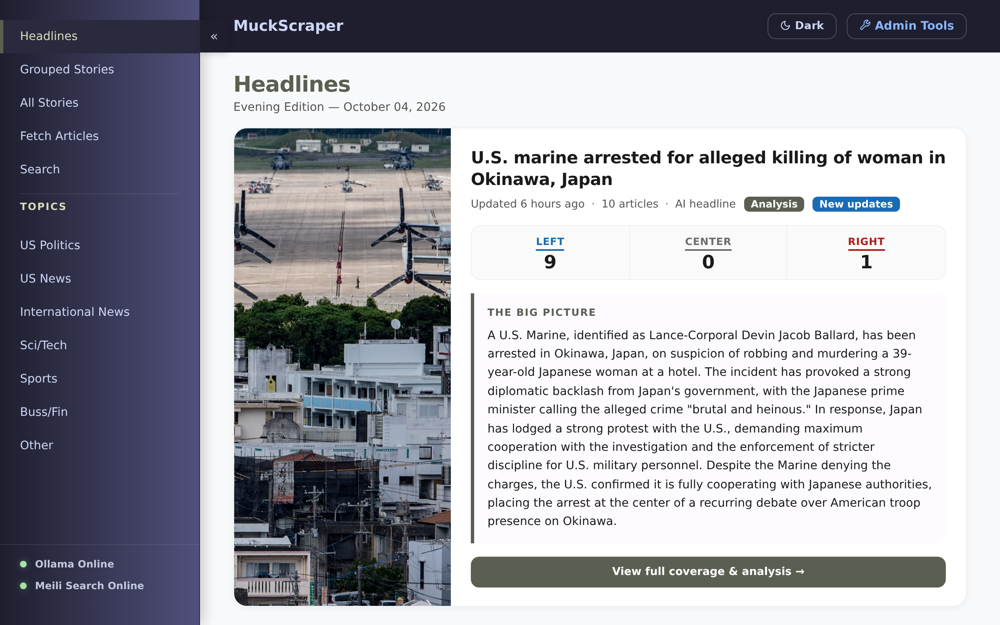
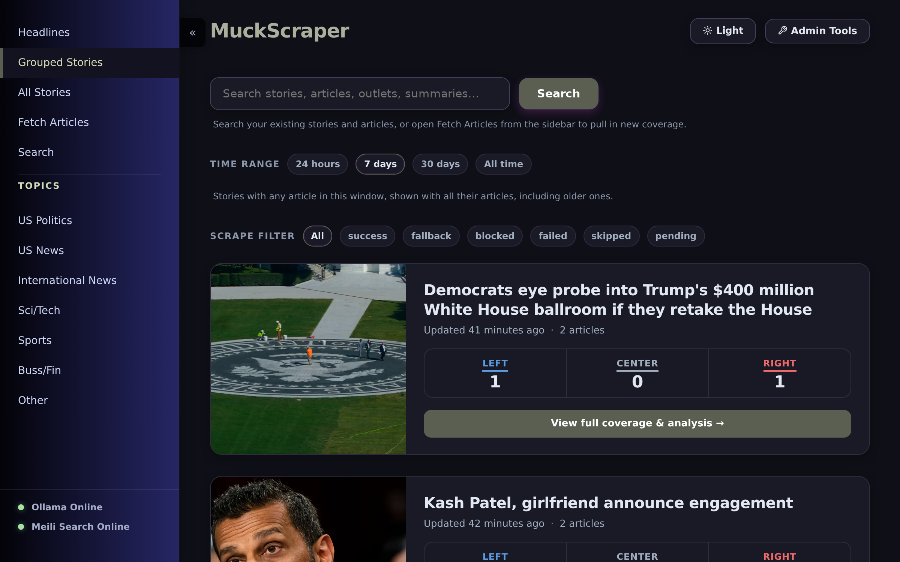
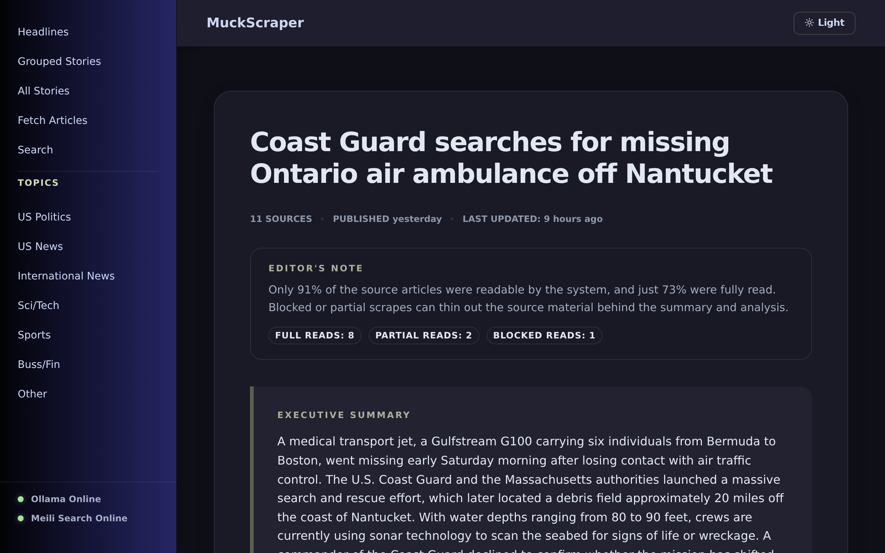
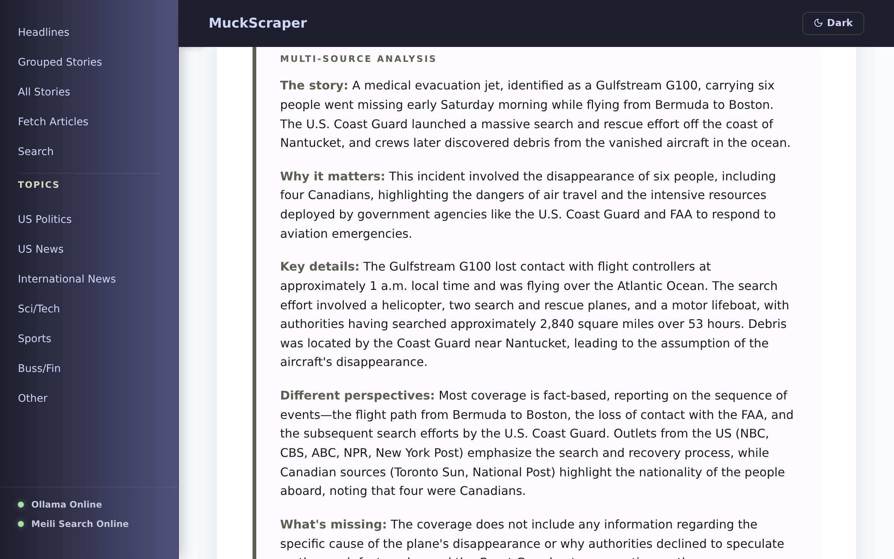
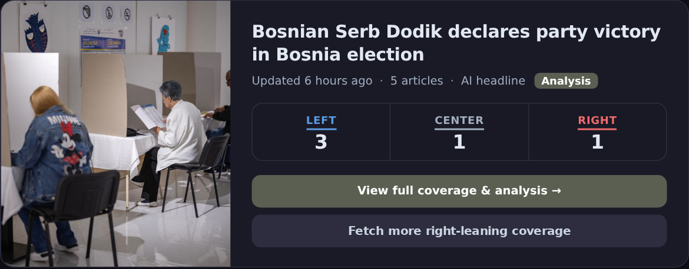
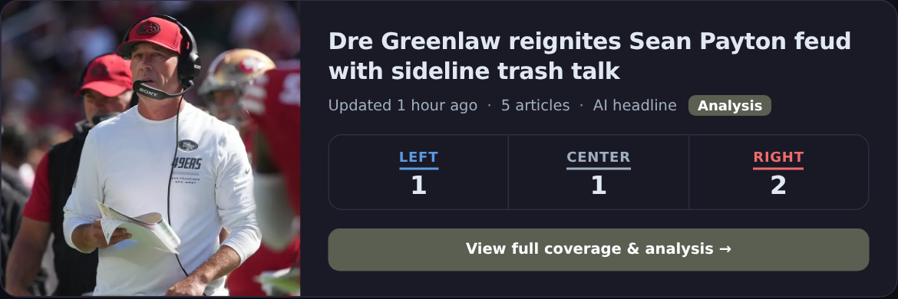
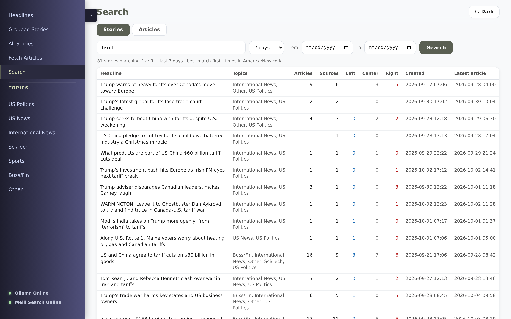
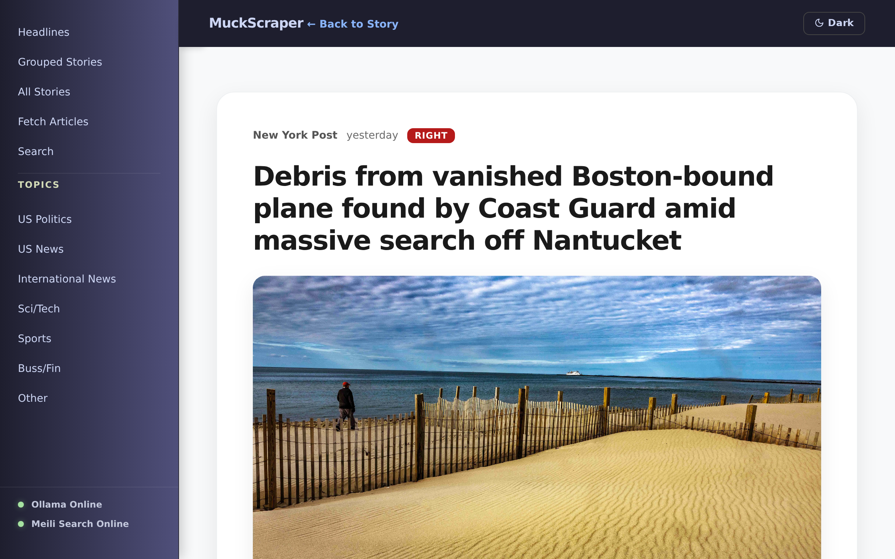
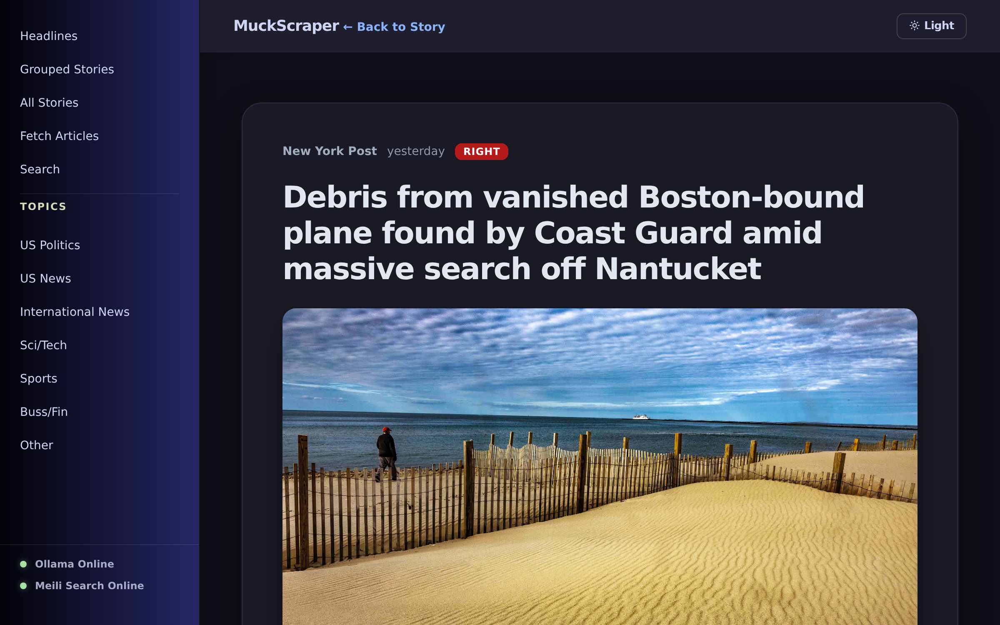

# MuckScraper

### A self-hosted news aggregator with multi-source grouping and local LLM analysis

> **TL;DR:** MuckScraper pulls news from multiple sources, groups related articles into stories, scores outlet bias, and generates local AI summaries and deeper reports on your own hardware.

---

## Try It First

- **[sample.muckscraper.news](https://sample.muckscraper.news)**: a public, read-only copy of this app, refreshed after every fetch run. It is what you get when you install it, minus the scraped article text (summaries and links to the publishers only).
- **[MuckScraper.news](https://muckscraper.news)**: a newspaper-style site built on the same pipeline. It publishes two balanced editions of 20 stories a day. The newspaper layer is not part of this repo; the aggregator it is built on is.

---

## What It Does

MuckScraper gathers and breaks down the news so you don't have to read the same story twelve times, unless you want to. A few times a day it pulls in articles from RSS feeds (and NewsAPI/GNews if you have keys), works out which ones are about the same event, and turns each pile into a single story. Each story gets one headline, a summary, a look at how the left, center and right are covering it, and a link to every source.

---

## Why It's Different

Most aggregators hand you a list of links. MuckScraper is built around stories, and it does the work on your own machine.

- **One story, every outlet.** Each new article is turned into an embedding (`nomic-embed-text`, stored in pgvector) and compared with recent stories. Close calls get a quick yes/no from the model. Twelve outlets reporting "Senate passes the bill" end up as one story instead of twelve links. Wire copies, where the same AP text runs under three mastheads, are spotted by text overlap and counted once.
- **Bias you can see.** Every outlet carries a left-to-right rating, from AllSides where they rate it and from the model where they don't. Each story shows how many left, center and right outlets covered it, and if one side trails, there's a button to go fetch more from it.
- **Summaries of real reporting.** The model summarizes and compares articles that reporters wrote; it never writes the news. A deep report sets out how the left, center and right are each covering the story, what's contested and what's missing. Guardrails throw out cut-off summaries and model errors posing as headlines, and a quality report flags any figure that doesn't appear in the sources.
- **Opinion in its own lane.** Op-eds never count as news coverage. They're kept separately, linked to the story they argue about, and summed up side by side.
- **Editions, not an endless feed.** Twice a day it picks a balanced edition of 20 stories, holding back repeats unless there's real new coverage. Every past edition stays readable.
- **It's yours, and so is your reading.** It runs in Docker on your own hardware, with Ollama by default. No subscriptions, no ads. Your server fetches every article from every side, so your ISP, or anyone else keeping tabs, only sees you collecting all the news. When you read the scraped copies, which stories you actually read stays on your own machine.

---

## Screenshots

### Headlines
The latest published edition, with each story's Left / Center / Right coverage count and summary.


### Grouped Stories (dark mode)


### Multi-Source Story View
One story, 88 articles from 22 outlets: the summary up top, then every source with its outlet's leaning.



### Opinion
Columns are kept out of the news but linked to the story they argue about, filed by the outlet's leaning, each with a one-line stance and a short roundup of what each side is saying.


### Bias Tags
Every card counts the left, center and right outlets covering the story; when one side trails, a button fetches more coverage from that side.



### Search
Stories and articles in dense, sortable tables, filtered by time window, with Left / Center / Right counts per story.


### Article Reader



### Past Editions


---

## Tech Stack

- **Backend:** Python, Flask, SQLAlchemy
- **Database:** PostgreSQL with pgvector
- **Search:** Postgres full-text search (`tsvector` + `pg_trgm`)
- **News Data:** NewsAPI and GNews, with RSS support
- **LLM Runtime:** Ollama by default; Gemini, Groq, or any OpenAI-compatible endpoint optional
- **Embeddings:** `nomic-embed-text`
- **Scraping:** BeautifulSoup, readability-lxml
- **Runtime:** Docker and Docker Compose

---

## Project Structure

```text
muckscraper/
├── aggregator/
│   ├── __init__.py                 # App factory
│   ├── app.py                      # Main Flask entry point
│   ├── models.py                   # SQLAlchemy models
│   ├── filters.py                  # Jinja filters and display helpers
│   ├── constants.py                # Shared constants (AGGREGATORS; TOPICS is dead, topics are DB-backed)
│   ├── display_time.py             # DISPLAY_TIMEZONE handling for shown dates
│   ├── html_safety.py              # Sanitising filters for scraped and LLM text
│   ├── seed_defaults.py            # Default topics, feeds, prompts and schedule for a fresh install
│   ├── article_signals.py          # Ingest heuristics: roundup/betting patterns, bias bucketing, independent-source checks
│   ├── search.py                   # Full-text search (Postgres)
│   ├── story_view.py               # Story view helpers
│   ├── blueprints/
│   │   ├── admin/                  # Admin and maintenance routes (package: articles, bulk_actions, config_crud, tools, ...)
│   │   ├── auth.py                 # Login/logout routes
│   │   └── public.py               # Public reader routes
│   ├── static/                     # Shared static assets (css/theme.css holds the colour tokens)
│   └── templates/                  # Jinja templates
├── docker_restart_proxy/           # Small service that lets the admin UI restart containers (and the MCP server read logs)
├── mcp_server/                     # Optional read-only MCP server for AI assistants (docs/MCP.md)
├── docs/                           # Longer guides (MCP.md)
├── migrations/                     # Alembic migration files
├── news_fetcher/
│   ├── Dockerfile                  # Scheduler image
│   ├── fetch_and_store_articles/   # Ingestion, grouping, and edition publishing (package)
│   ├── llm_client.py               # LLM provider dispatch (Ollama, Gemini, Groq, OpenAI-compatible)
│   ├── prompt_registry.py          # DB-backed prompt templates
│   ├── quality_checks.py           # Output-quality detectors (pure functions)
│   ├── quality_report.py           # Read-only quality report for a run
│   ├── rss_fetcher.py              # RSS ingestion helpers
│   ├── google_news.py              # Resolves Google News search-feed links to publisher URLs
│   ├── copy_detector.py            # Marks copied articles (wire copies) within a story
│   ├── opinion_linker.py           # Links Op/Ed columns to stories, writes opinion roundups
│   ├── scheduler.py                # Scheduled fetch runner
│   ├── scraper.py                  # Scrape pipeline and fallback logic
│   ├── story_grouper.py            # Story clustering logic
│   ├── summarizer.py               # Story and article summaries
│   ├── topic_classifier.py         # Topic classification helpers
│   ├── headline_generator.py       # AI headline generation for grouped stories
│   ├── allsides_lookup.py          # AllSides bias data lookup
│   ├── outlet_bias_llm.py          # LLM-based outlet bias scoring
│   ├── backfill_images.py          # Utility: backfill missing story images
│   ├── cleanup_duplicates.py       # Utility: deduplicate articles and stories
│   └── merge_outlets.py            # Legacy script; use Merge Outlets in Admin Tools instead
├── tests/                          # Automated tests
├── boot.sh                         # Docker app entrypoint
├── install.sh                      # First-time setup and upgrades
├── bootstrap_admin.py              # Admin user creation script
├── docker-compose.yml              # Local stack definition
├── Dockerfile                      # App image
├── requirements.txt                # Python dependencies
└── .env.sample                     # Example environment configuration
```

---

## Security Warning

By default every page requires a login. Setting `PUBLIC_READ_ACCESS=true` (see Accounts and public access) opens the reading pages to signed-out visitors. The app is built as a private admin tool either way, so don't expose it directly to the public internet.

Recommended deployment:
- keep the admin interface on a local network
- or put it behind a VPN such as WireGuard or Tailscale

---

## Requirements

- Docker with the Compose v2 plugin (`docker compose`). PostgreSQL with pgvector runs as part of the stack.
- An LLM provider: Ollama by default, or Gemini, Groq, or any OpenAI-compatible endpoint
- An embedding provider: Ollama (`nomic-embed-text`) or Gemini
- Optional: NewsAPI and GNews API keys. Each source is skipped if its key is blank; the default RSS feeds work without either.

### Hardware

What the live deployment runs on, as a guide:

- **The Docker stack:** 2 CPU cores and 8 GB of RAM is plenty (the containers use about 1.5 GB between them). Allow about 10 GB of disk for the images, plus the database: about 1 GB for 120,000 articles over six months, including its search indexes.
- **The LLM:** a GPU makes the difference. A full run makes about 1,200 LLM calls, one after another, so every second per call adds up. The live site uses a 10 GB GPU with `gemma4:12b-it-qat` (`OLLAMA_THINK=false`) and `nomic-embed-text`, both held on the GPU together; a full run of 250-300 new articles takes 25-35 minutes. On a smaller card, `gemma4:e4b-it-qat` (about 3 GB of VRAM) works. Ollama can run on a different machine from the stack (set `OLLAMA_HOST`).
- **Ollama's context size:** set `OLLAMA_CONTEXT_LENGTH` to at least `16384` on the Ollama server (in its service environment, not in this `.env`). Older Ollama versions default to 4,096 tokens, which cuts off long story-summary prompts. MuckScraper never asks for a context size per call, so the server's setting is what every call gets.
- **No GPU?** Send the summaries, or everything, to a cloud provider instead; see LLM behavior below.

---

## Installation

```bash
git clone https://github.com/grregis/muckscraper.git
cd muckscraper
./install.sh
```

The first run creates `.env` from `.env.sample`, fills in `SECRET_KEY`
for you, and stops so you can fill in the rest. At
minimum set `OLLAMA_HOST`, `OLLAMA_MODEL`, `EMBEDDING_MODEL`
(`nomic-embed-text`) and `ADMIN_PASSWORD`; pull both models on your Ollama
box first (`ollama pull ...`). Change the Postgres password too. News API
keys are optional.

Run `./install.sh` again once that's done. It builds the images (a few
minutes the first time), sets up the database (pgvector extension + tables),
creates the admin user, and starts the scheduler. Safe to re-run: on an
existing install it applies any pending migrations rather than skipping them.
(A very old install with tables but no migration history stops with
instructions instead of guessing its schema version.)

Then open `http://localhost:5000` and sign in with `ADMIN_USERNAME` /
`ADMIN_PASSWORD` from `.env`. The app only listens on localhost; to reach it
from another machine, set `APP_BIND=0.0.0.0` (or a LAN address) in `.env` and
run `docker compose up -d app`, after reading Security Warning above.
`APP_PORT` moves it off port 5000.

**What to expect on day one.** The scheduler starts a first run as soon as it
comes up. On an empty database it has hundreds of new articles to group and
summarize, so it takes a good while longer than a normal run; watch it with
`docker compose logs -f scheduler`. Headlines stays empty until the first
full run publishes an edition. After that, runs follow the schedule: full
runs at 7:00 and 17:00 and fetch-only runs at 12:00 and 22:00, US Eastern
time. Change them at `/admin/pipeline-schedule` (then restart the scheduler).

<details>
<summary>Manual steps (if you'd rather not use install.sh)</summary>

```bash
cp .env.sample .env && chmod 600 .env
# Edit .env: Ollama host and models, admin password, and SECRET_KEY from:
#   python3 -c "import secrets; print(secrets.token_hex(32))"
docker compose up -d --build postgres app
docker compose exec app python bootstrap_admin.py
docker compose up -d scheduler
```

</details>

### Accounts and public access

Add accounts at **Users** in the account menu (top right). Each has one of three roles:

- **Reader**: reads everything, including full article text and search, and changes nothing.
- **Scraper**: also fetches articles and runs summaries, analysis, bias ratings and scrapes.
- **Admin**: also uses Admin Tools, changes all configuration, and manages users.

Everyone can change their own email and password on their **Profile**.

Set `PUBLIC_READ_ACCESS=true` in `.env` to let signed-out visitors read Headlines, All Stories, Grouped Stories (with the topic filters), story pages and article summaries. Search and Fetch still need an account. Signed-out visitors never see scraped full text, scrape details or any button that runs work. It is off by default; after changing it, run `docker compose up -d app`.

Dates are shown in the time zone set by `DISPLAY_TIMEZONE` in `.env` (an IANA name such as `America/New_York`; default `UTC`). After changing it, run `docker compose up -d app`; a plain restart doesn't re-read `.env`.

### Upgrading

```bash
git pull
./install.sh
```

`install.sh` rebuilds the images and applies any database migrations. Read the
release's `CHANGELOG.md` entry first. To run only the migrations:
`docker compose exec app flask db upgrade`.

**Upgrading within a major version (e.g. `1.x` → `1.y`) never breaks your
stored config or customizations** — topics, RSS feeds, prompts, scheduled
fetches, and ingestion blocks you've edited stay as you left them.
Config-breaking changes are reserved for major version bumps (`1.x` →
`2.0`) and always called out explicitly in that release's `CHANGELOG.md`
entry, never shipped silently in a minor/patch upgrade.

### Optional workflow integrations

MuckScraper can be extended with personal workflow hooks, such as n8n webhooks for fetch reports or Ollama power management, and Matrix notifications for status messages. These are not part of the default Docker Compose setup; add them with your own environment variables, compose override, or notification code if you want those workflows.

### MCP server for AI assistants (optional)

An optional, read-only [MCP](https://modelcontextprotocol.io) server lets an AI assistant (Claude, or a local agent on your own Ollama) check on the install: whether a run is in progress, how the last run went, whether Ollama is asleep or broken, what is in an edition, and the documented fix for a symptom. It cannot change anything. Set `MCP_TOKEN` in `.env` and start it with `docker compose --profile mcp up -d --build mcp docker-restart-proxy`. See [docs/MCP.md](docs/MCP.md) for the tools, setup and client examples.

---

## Current Features

### Editions and ranking
- Configurable scheduled editions per day
- Past editions page, grouped by month, each edition readable as it was published plus anything added to its stories since
- Opinion page per edition: the stories that got new opinion columns, with each column's stance
- 20-story edition target
- Repeats held back unless there is meaningful new coverage
- Carry-over logic for underfilled editions
- Publish-time duplicate-story filtering for same-event headline candidates

### News fetching
- Scheduled multi-topic fetches
- On-demand fetch by topic or custom query
- NewsAPI and GNews support
- RSS ingestion support, with an optional fallback URL per feed for when a feed goes down
- Outlets without a working feed can come in through Google News search feeds; links are resolved to the publisher's own URL before anything is stored
- Duplicate article detection by URL and normalized title/outlet checks
- Copied articles (wire copies, one outlet running another's piece) marked and not counted as extra sources
- Junk filtered before storage: betting picks, fantasy advice, roundups, editorial cartoons, plus your own source and title blocks
- Full-text search across articles and stories in Postgres, always current (no index to rebuild), with prefix and typo matching for as-you-type search

### Scraping and reliability
- Full article scraping during ingestion
- Multi-step scrape fallback pipeline
- Scrape telemetry stored per article
- Bad-scrape auditing and status-aware retries
- Domain and URL cooldown behavior for repeated failures
- Admin monitoring for scrape outcomes and blocklist behavior

### Story grouping and summaries
- Vector-based story grouping with pgvector
- LLM-assisted borderline match handling
- AI story headlines for grouped stories
- Story summaries and deeper reports
- Per-article summaries and deep analysis for edition articles
- Op/Ed kept apart from the news: its own page, opinion RSS feeds, columns linked to the stories they argue about, and a short opinion roundup per story
- Stable-story skipping so unchanged stories do not keep reprocessing

### Reading and search
- Headlines, Grouped Stories (two or more articles) and All Stories views, with topic filters
- Time windows (24 hours, 7 days, 30 days, all time) on the story lists and search
- Search page with sortable Stories and Articles tables and custom date ranges
- Back to Feed returns to the card or search row you left
- Relative timestamps ("3 hours ago") with the exact local time on hover
- Light and dark themes
- Reader, Scraper and Admin accounts, and optional public read-only access

### Bias and metadata
- Outlet bias labels with AllSides or model-based sourcing
- Topic classification
- Image capture from upstream feeds
- Archived edition-story image support for stable published output

### Admin tools
- Manual scrape and rescrape actions
- Bulk scrape-missing workflow
- Scrape audits
- Ollama helpers: wake the Ollama box, and catch up after an outage (missing embeddings, regrouping of single-article stories, headlines) plus topic reclassification
- Outlet merge tooling
- Topic, RSS feed, scheduled fetch and ingestion blocklist management
- Editable LLM prompts, each resettable back to its original default
- Pipeline run schedule management (add/edit/delete when fetch-only vs. full-pipeline runs happen)
- Container restart from the admin UI, blocked automatically while a fetch or other background task is running

---

## Customization

### Topics, feeds, queries, prompts, filters, and schedule

All DB-backed and admin-editable, no code change needed:
- Topics: `/admin/topics`
- RSS feeds: `/admin/rss-feeds`
- LLM prompts: `/admin/prompts` (each resettable back to its original default)
- Pipeline run schedule — *when* fetch-only vs. full-pipeline runs happen: `/admin/pipeline-schedule`
- Scheduled fetches — *what* each run pulls from NewsAPI/GNews: `/admin/scheduled-fetches`
- Ingestion blocklist — sources and headline keywords refused before anything is
  stored: `/admin/ingestion-blocks`

The shipped defaults (US-centric topics, a gaming-news filter) are only a
starting point. Change them on these pages to suit your own beat.

### LLM behavior

**Choosing a provider (`LLM_PROVIDER`).** Ollama is the default and the point of
the project, but `LLM_PROVIDER` also accepts `gemini`, `groq`, and `openrouter`.
The OpenRouter path is a generic OpenAI-compatible client — set `OPENROUTER_HOST`
to any endpoint speaking `chat/completions` (DeepSeek, OpenAI, Together, a local
vLLM) and it works with no code change. Embeddings are a separate axis
(`EMBEDDING_PROVIDER`) and only Ollama and Gemini can serve them; Groq has no
embedding models and OpenRouter routes chat completions only.

**Splitting the two workloads (`LLM_FAST_PROVIDER`).** A run makes ~1,140
mechanical calls against ~65 summary/deep-report calls (see below). Those two
groups can go to *different* providers, which is the answer to "my GPU can't run
a model good enough for summaries":

```
LLM_PROVIDER=openrouter      # the ~65 summaries and deep reports
LLM_FAST_PROVIDER=ollama     # the ~1,140 grouping/classification/bias calls
```

The volume stays local and free; only the handful of calls a reader actually
sees go to the cloud. `LLM_PROVIDER` is the summary provider and
`LLM_FAST_PROVIDER` overrides it for the mechanical calls; leave
`LLM_FAST_PROVIDER` blank to send everything to one provider.

Health checks are per-tier, so the pipeline degrades rather than stops: if the
local box is asleep, summaries still run and only classification is skipped, and
vice versa.

**Model tiers (`OLLAMA_FAST_MODEL`).** A full pipeline run makes roughly 1,200
sequential LLM calls, and about 1,140 of them are mechanical — story-grouping
confirmations, topic classification, headline generation, outlet bias — whose
output is a label, a yes/no, or a short headline. Only ~65 are the summaries and
deep reports a reader actually sees. Setting `OLLAMA_FAST_MODEL` to a smaller
model routes the mechanical calls to it while summaries stay on `OLLAMA_MODEL`.

This matters most when `OLLAMA_MODEL` is too large for your GPU. Compare
`size_vram` against `size` in `curl $OLLAMA_HOST/api/ps` — if `size_vram` is
smaller, the rest is running on CPU and every call pays for it. Worse, a model
that fills the card leaves no room for the embedding model, so Ollama swaps the
two in and out on every article. A fast model that fits alongside
`nomic-embed-text` avoids both problems.

Leave it blank to use `OLLAMA_MODEL` for everything.
`GEMINI_FAST_MODEL` and `GROQ_FAST_MODEL` do the same for those providers.

Prompt wording itself is editable at `/admin/prompts` (see above) with no
code change needed. The surrounding logic — persona/analysis-type
selection, story-grouping thresholds, etc. — lives in:
- `news_fetcher/summarizer.py`
- `news_fetcher/topic_classifier.py`
- `news_fetcher/story_grouper.py`
- `news_fetcher/headline_generator.py`
- `news_fetcher/outlet_bias_llm.py`
- `news_fetcher/allsides_lookup.py` (bias data source)

### Scrape and grouping tuning

Important knobs include:
- similarity thresholds in `news_fetcher/story_grouper.py`
- heuristic ingest filters (roundup/advice-column/betting title patterns) in
  `aggregator/article_signals.py` — the source and headline-keyword blocklists
  themselves are admin-editable at `/admin/ingestion-blocks`
- retry and cooldown behavior in `news_fetcher/scraper.py`

---

## Notes

- Release history and upgrade notes: [CHANGELOG.md](CHANGELOG.md).
- This repo intentionally documents the main application and ingestion pipeline, not every deployment-specific integration.
- Optional local integrations can exist around the core stack without being required for the open-source app itself.

---

## Special Thanks

- **[Langfuse](https://langfuse.com/)** — LLM observability and tracing, invaluable for debugging prompts and iterating on model behavior during development.
- **[AllSides](https://www.allsides.com/)** — outlet bias ratings that inform MuckScraper's bias labeling. Their commitment to balanced news exposure is very much in the spirit of this project.
